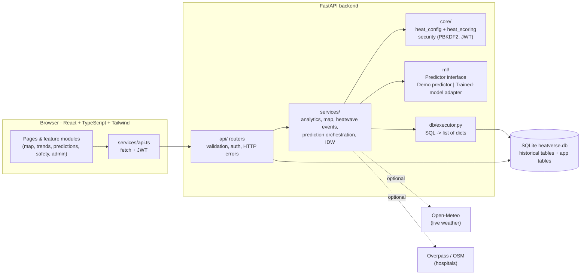

# Architecture

## Heat-risk pipeline

`Weather data (DB) → feature preparation → predictor → score (heat_scoring) → category → explanation → dashboard / map`

* **Observed map & dashboard:** SQL gets the day's observations + 6 previous days (for the hot-day streak) → `compute_score` → category.
* **Prediction:** `prediction_service.run_prediction` asks the active predictor for expected values or a probability, scores them, applies the documented personal adjustments, builds a rule-based explanation and stores everything in `prediction`.

## Layering rules (why the code is split this way)

* `api/` only handles HTTP: validation, authentication, status codes. No SQL for weather data.
* `services/` contains the logic and depends only on `db.rows(sql, params)`, so it can be tested without the web framework (`SqliteExecutor`) and run in production through SQLAlchemy (`SAExecutor`).
* `core/heat_config.py` is the single place for thresholds and weights.
* There is **no route that writes to `weather_observation`**, so historical data cannot be changed by users or admins through the app.

## Security design

* Passwords: PBKDF2-HMAC-SHA256, 600,000 iterations, random salt. Plain text is never stored or logged.
* Sessions: signed JWT (HS256) in the `Authorization: Bearer` header. The role is re-read from the database on every request, so demoting or deactivating an account takes effect immediately.
* Admin routes: router-level `require_admin` dependency (HTTP 401 without a token, 403 for normal users). The first admin is created from the command line with a hidden password prompt.
* CORS: only the origins in `CORS_ORIGINS`; credentials not allowed; limited methods/headers.
* Secrets live in `backend/.env` (git-ignored). `SECRET_KEY` falls back to a random per-run value (with a warning) if missing.
* Limits you should know about: no login rate-limiting, no server-side token revocation (logout just discards the token), JWT stored in `localStorage` (readable by any XSS bug; acceptable for a coursework project, not for production).

## Connecting a trained ML model

No model was supplied, so the app runs a clearly labelled **demo predictor** (`ml/demo_predictor.py`): the 2000–2024 average of Tmax/Tmin/apparent Tmax within ±7 days of the target day-of-year, scored with the normal formula. It has no confidence value and no accuracy.

To plug in your own model:

1. Train a scikit-learn-style classifier whose `predict_proba(X)[:, 1]` is P(heatwave within the horizon). Save it: `joblib.dump(model, "heatwave_model.joblib")`.
2. Edit `FEATURE_ORDER` in `backend/app/ml/feature_spec.py` to match your training columns, in order.
3. `pip install joblib scikit-learn` (versions must match the ones used for training).
4. Put the file somewhere (e.g. `backend/models/heatwave_model.joblib`) and set `MODEL_PATH=models/heatwave_model.joblib` in `backend/.env`. Restart the backend.
5. Check `GET /api/predictions/model-status` or the Admin → Overview health panel. If loading fails, the app falls back to the demo predictor and says why.

Notes: the adapter builds features from the **latest observations in the database** (they end on 2024-12-31), reports the model's raw probability, and never fabricates confidence, accuracy or SHAP values. Different model types need a small change in `ml/sklearn_predictor.py`. **The adapter has not been tested with a real model.**
