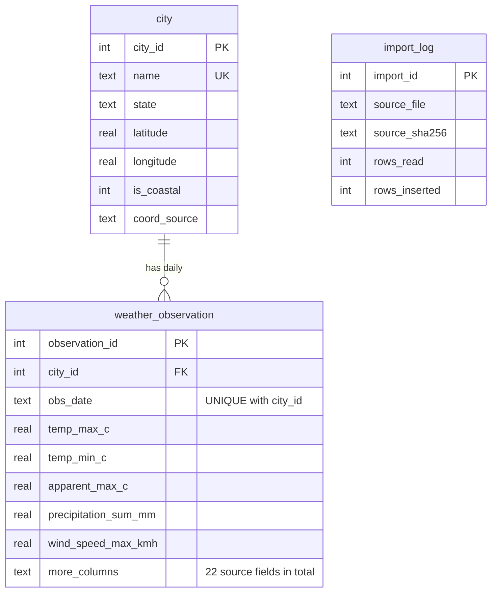

# Database schema

One SQLite file (`database/heatverse.db`) holds two groups of tables.

## 1. Historical tables (created by `scripts/import_excel.py`; read-only for the application)

Source file inspected: `DBMS_Database.xlsx`, one sheet `india_2000_2024_daily_weather`.

| Fact found in the source | Value |
|---|---|
| Rows | 91,320 |
| Columns | 22 |
| Cities | 10 (Ahmedabad, Bangalore, Chennai, Delhi, Hyderabad, Jaipur, Kolkata, Lucknow, Mumbai, Pune), 9,132 rows each |
| Date range | 2000-01-01 → 2024-12-31 (no missing days) |
| Missing (empty) cells | 0 |
| Duplicate (city, date) rows | 0 |
| **Not present** | **humidity, pressure, latitude/longitude** — none were invented |
| Redundancy | `ppt_sum` and `rain_sum` are identical in every row (kept as imported) |



* `UNIQUE (city_id, obs_date)` doubles as the index for per-city range queries; `idx_obs_date (obs_date, city_id)` serves the map's "all cities on one date" query.
* Dates are ISO text (`YYYY-MM-DD`), which sorts correctly and works with SQLite date functions.
* Column mapping (Excel → database): `temp_2m_max(°C)`→`temp_max_c`, `temp_2m_min(°C)`→`temp_min_c`, `apparent_temp_max(°C)`→`apparent_max_c`, `apparent_temp_min(°C)`→`apparent_min_c`, `ppt_sum`→`precipitation_sum_mm`, `rain_sum`→`rain_sum_mm`, `weather_code`, `wind_speed_10m_max`→`wind_speed_max_kmh`, `wind_gusts_10m_max`→`wind_gusts_max_kmh`, `wind_direction_10m_dominant`→`wind_direction_deg`, `temp_2m_mean (°C)`→`temp_mean_c`, `apparent_temp_mean (°C)`→`apparent_mean_c`, `sunrise/sunset (iso8601)`, `daylight_duration (s)`→`daylight_duration_s`, `sunshine_duration (s)`→`sunshine_duration_s`, `et0_fao_evapotranspiration (mm)`→`et0_evapotranspiration_mm`, soil moisture/temperature, `precipitation_hours (h)`→`precipitation_hours_h`.
* **Units:** the Excel headers give no unit for `ppt_sum`, `rain_sum` and the wind columns; they are treated as mm and km/h (the Open-Meteo convention). Confirm this with your data source if it matters for your report.
* **Transformations:** only column renaming, trimming city names, and converting dates/sunrise/sunset to ISO text. No row was dropped or changed (verified: values compared against the Excel file).
* **Coordinates** come from `city_metadata.csv`, not from the dataset (see `map-data-sources.md`).

## 2. Application tables (created by the app at start-up)

```mermaid
erDiagram
    user_account ||--|| user_profile : has
    user_account ||--o{ prediction : makes
    city ||--o{ prediction : "for"
    city ||--o{ alert : "optional scope"
    city ||--o{ safety_resource : "optional scope"
    user_account ||--o{ audit_log : performs
    user_account ||--o{ alert : creates
    user_account {
        int user_id PK
        text email UK
        text password_hash "PBKDF2-SHA256, never plain text"
        text role "user | admin (CHECK)"
        bool is_active
    }
    user_profile {
        int profile_id PK
        int user_id FK_UK
        int age "0-120 (CHECK)"
        int home_city_id FK
        bool is_outdoor_worker
        text activity_level "low|moderate|high (CHECK)"
        text theme
    }
    prediction {
        int prediction_id PK
        int user_id FK
        int city_id FK
        text target_date
        int horizon_days "0-14 (CHECK)"
        text model_name
        text model_version
        bool is_demo
        int risk_score "0-100 (CHECK)"
        real heatwave_probability "NULL unless a real model gave it"
        real confidence "NULL unless a real model gave it"
        json details
    }
    alert {
        int alert_id PK
        int city_id FK
        text level "info|advisory|warning"
        text title
        bool is_active
    }
    safety_resource {
        int resource_id PK
        int city_id FK
        text name
        text phone
        text source_note "required"
    }
    audit_log {
        int audit_id PK
        int actor_user_id FK
        text action
        text target
    }
```

Foreign-key enforcement is switched on for every connection (`PRAGMA foreign_keys=ON`). Deleting a user cascades to their profile and predictions.
Prediction history *is* the `prediction` table filtered by `user_id` (indexed on `user_id, created_at`).
